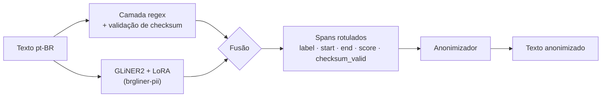
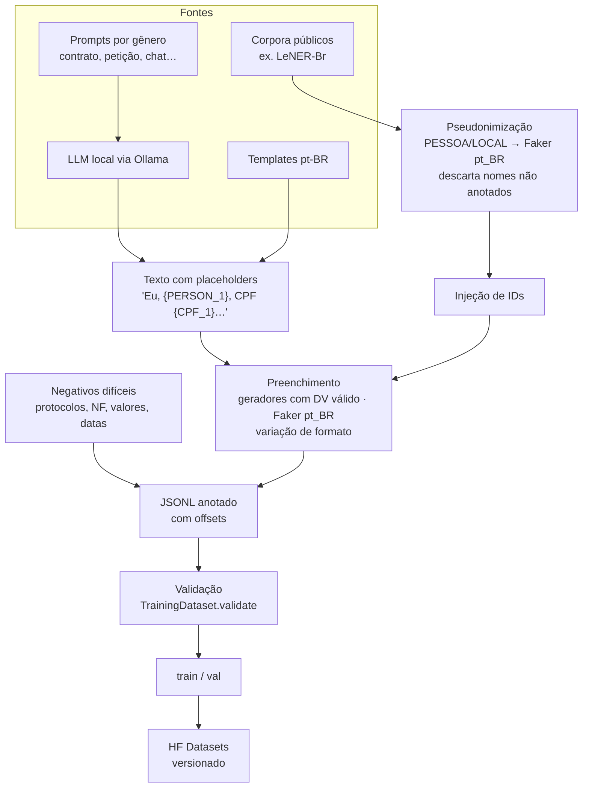
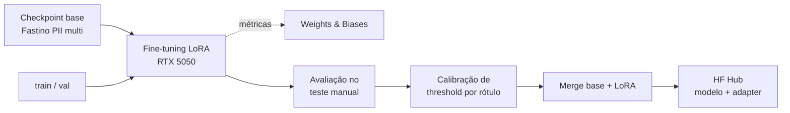

# brgliner — Brazilian GLiNER para dados sensíveis

> 🇬🇧 **TL;DR (English)** — `brgliner` is an open-source project to detect and anonymize
> **Brazilian bureaucratic PII** (CPF, CNPJ, RG, CNH, PIS, voter ID, SUS card, CNJ lawsuit
> numbers, vehicle plates, PIX keys…) in Portuguese text. It combines a **regex + checksum**
> layer with a **GLiNER2** model (`fastino/gliner2-privacy-filter-PII-multi`, mDeBERTa-v3)
> fine-tuned with **LoRA** on **fully synthetic** pt-BR data. Deliverables: model + dataset on
> Hugging Face, a `pip install brgliner` package and a Gradio demo. No real personal data is
> ever used.

> 🚧 **Status:** em construção — fase 0 (setup). Veja o [roadmap](#-roadmap).

---

## Sumário

- [Por que este projeto existe](#-por-que-este-projeto-existe)
- [Objetivos e escopo](#-objetivos-e-escopo)
- [Entidades da v1](#-entidades-da-v1)
- [Arquitetura](#-arquitetura)
- [Pipeline de dados sintéticos](#-pipeline-de-dados-sintéticos)
- [Treino](#-treino)
- [Avaliação](#-avaliação)
- [Infraestrutura e ambiente](#-infraestrutura-e-ambiente)
- [Estrutura do repositório](#-estrutura-do-repositório)
- [Qualidade, CI e releases](#-qualidade-ci-e-releases)
- [Privacidade e LGPD](#-privacidade-e-lgpd)
- [Roadmap](#-roadmap)
- [Registro de decisões](#-registro-de-decisões)
- [Referências](#-referências)

---

##🎯 Por que este projeto existe

Modelos abertos de detecção de PII, como o
[`fastino/gliner2-privacy-filter-PII-multi`](https://huggingface.co/fastino/gliner2-privacy-filter-PII-multi),
já entendem português, mas usam **rótulos genéricos** (`tax_id`, `national_id_number`,
`drivers_license_number`…). Eles não distinguem **CPF de RG**, **CNH de título de eleitor**, nem
conhecem um **número de processo CNJ**, uma **placa Mercosul** ou uma **chave PIX**.

Além disso, o próprio modelo declara que a **precisão é o ponto fraco** (~0,35 no benchmark SPY)
e que os dados de treino **não foram revisados por humanos**.

O `brgliner` ataca essa lacuna: um detector **especializado na burocracia brasileira**, avaliado
contra um conjunto de teste **revisado à mão**, e honesto sobre quando o modelo realmente agrega
valor em relação a uma regex bem feita.

##  Objetivos e escopo

**Objetivo principal:** aprender, de ponta a ponta, o processo de construir um modelo de NER
(ideia → arquitetura → dados → treino → avaliação → publicação) e terminar com um artefato
público e útil.

| | Dentro da v1 | Fora da v1 |
|---|---|---|
| **Tarefa** | Detectar entidades (spans + rótulo + confiança) e anonimizar o texto | Extração de relações (ex.: filiação `mae_de`) |
| **Textos** | Formais (contratos, petições, certidões, ofícios, Diário Oficial) e informais (chat, WhatsApp, e-mail) | Texto vindo de OCR, logs/JSON/CSV |
| **Idioma** | Português do Brasil | Outros idiomas (aceitamos perda de desempenho neles) |
| **Entrega** | Modelo, dataset, pacote PyPI e demo no HF Space | API REST, Docker, deploy em produção |

##  Entidades da v1

Os rótulos ficam em sigla ou em inglês (o GLiNER usa o *nome* do rótulo como sinal semântico, e o
backbone é multilíngue).

### Identificadores brasileiros

| Rótulo | O que é | Formato típico | Validação |
|---|---|---|---|
| `cpf` | Cadastro de Pessoa Física | `123.456.789-09` / 11 dígitos | DV módulo 11 |
| `cnpj` | Cadastro Nacional da Pessoa Jurídica | `12.345.678/0001-95` — inclui o **CNPJ alfanumérico** (IN RFB 2.229/2024) | DV módulo 11 |
| `rg` | Registro Geral | varia por UF, ex. `12.345.678-9` | sem padrão nacional |
| `cnh` | Carteira Nacional de Habilitação | 11 dígitos | DV |
| `pis` | PIS / PASEP / NIT | `123.45678.90-1` | DV |
| `titulo_eleitor` | Título de eleitor | 12 dígitos | DV + código da UF |
| `cns` | Cartão Nacional de Saúde (SUS) | 15 dígitos | módulo 11 |
| `processo_cnj` | Número único de processo judicial | `NNNNNNN-DD.AAAA.J.TR.OOOO` | DV módulo 97 |
| `oab` | Inscrição na OAB | `OAB/SP 123.456` | — |
| `placa` | Placa de veículo | `ABC-1234` (antiga) / `ABC1D23` (Mercosul) | formato |
| `renavam` | Registro do veículo | 11 dígitos | DV |
| `chave_pix` | Chave PIX | e-mail, telefone, CPF/CNPJ ou aleatória (UUID) | pelo contexto |
| `conta_bancaria` | Agência e conta | `ag. 1234 c/c 56789-0` | — |
| `cep` | Código postal | `01310-100` | formato |

### PII genérica

| Rótulo | Observação |
|---|---|
| `person` | Nome de pessoa física |
| `address` | **Logradouro + número + complemento** (bairro, cidade e CEP saem como spans separados — o modelo base limita spans a 8 palavras) |
| `phone` | `+55 (11) 91234-5678`, `11 912345678`… |
| `email` | — |
| `birth_date` | Data de nascimento (não qualquer data) |

**Ficam para a v2:** CTPS, passaporte, certidões (matrícula), inscrição estadual/municipal,
CRM/CREA/CRP, chassi e filiação (como relação).

> **Regra de rotulagem:** o modelo rotula **pelo contexto**, não pelo checksum. Um "CPF" com
> dígito verificador errado (erro de digitação) continua sendo dado sensível e deve ser
> detectado. A camada de regex apenas anexa o metadado `checksum_valid`.

##  Arquitetura

O detector é **híbrido**: regex + checksum para o que tem formato fixo e um modelo GLiNER2 para o
que depende de contexto (números sem formatação, "esse número é RG ou CNH?", nomes, endereços).

> **Nenhum LLM participa da detecção.** O LLM (Ollama) só é usado offline, como fábrica de dados
> de treino. Na inferência, quem decide é a regex, o GLiNER e as regras fixas de fusão: o texto
> sensível nunca vai para um LLM, a resposta sai em milissegundos na CPU e o resultado é
> determinístico.



### Regras de fusão

1. **União** dos spans das duas fontes — prioridade é recall.
2. Sobreposição em **rótulo de ID** → vence a **regex com checksum válido**.
3. Sobreposição em **rótulo genérico** (`person`, `address`…) → vence o **modelo**.
4. Demais casos → vence o **span mais longo**; empate → **maior confiança**.
5. **Threshold por rótulo**, calibrado no conjunto de validação (não um 0,5 fixo).

### Estratégias de anonimização

| Estratégia | Exemplo de saída |
|---|---|
| `tag` | `Meu CPF é [CPF]` |
| `mask` | `Meu CPF é ***.456.789-**` |
| `fake` | `Meu CPF é 987.654.321-00` — valor falso **válido e consistente** (a mesma entrada vira sempre o mesmo falso dentro de um documento) |

### API planejada

```python
from brgliner import Detector, Anonymizer

detector = Detector.from_pretrained("JoaoVCO/brgliner-pii-v1")
spans = detector.detect("Eu, Maria Souza, CPF 123.456.789-09, residente na Rua das Flores, 42.")

Anonymizer(strategy="mask").apply(text, spans)
```

##  Pipeline de dados sintéticos

**Nenhum dado pessoal real entra no projeto.** Todo o treino é sintético, e o LLM **nunca** inventa
os valores sensíveis: ele escreve o texto com *placeholders*, e os nossos geradores preenchem com
valores válidos. Assim os offsets das anotações saem exatos e de graça.



**Corpora públicos (LeNER-Br):** são decisões judiciais reais, com nomes de pessoas reais. Antes
de entrar no pipeline, todo span anotado como `PESSOA` ou `LOCAL` é trocado por um valor do Faker
pt_BR, e frases com nomes que o corpus não anotou são descartadas. Esses nomes são procurados
pelo próprio checkpoint base da Fastino em zero-shot (rótulo `person`, threshold baixo ≈ 0,3):
na dúvida a frase é descartada, porque jogar uma frase fora é barato. Do corpus aproveitamos só a estrutura e o vocabulário jurídico. Bônus técnico: o
LeNER-Br repete muito os mesmos nomes (ministros, desembargadores), e a troca evita que o modelo
decore nomes em vez de aprender o contexto.

**Variação de formato:** o mesmo CPF aparece como `123.456.789-09`, `12345678909`,
`123 456 789 09`, `cpf:12345678909` etc. O modelo precisa reconhecer todos.

**Composição da v1:**

| Item | Valor |
|---|---|
| Tamanho | ~6.000 exemplos de treino + ~600 de validação |
| Fontes | ~50% LLM + placeholders · ~35% templates · ~15% corpora públicos com IDs injetados |
| Gênero | ~50% formal · ~50% informal |
| Negativos difíceis | ~15–20% dos exemplos (rótulo vazio, ex. `"cpf": []`) |

**LLM gerador:** roda localmente via Ollama (custo zero). O modelo é escolhido num *bake-off*:
`qwen3:8b` × `gemma3:4b` geram 20 textos cada com o mesmo prompt, e vence o português mais natural.

**Formato (GLiNER2):**

```json
{"input": "Eu, Maria Souza, CPF 123.456.789-09…", "output": {"entities": {"person": ["Maria Souza"], "cpf": ["123.456.789-09"], "cnh": []}}}
```

**Reprodutibilidade:** os dados não vão para o git (`data/` é ignorado). Todo dataset é
regenerável por script com **seed fixa** e é versionado quando publicado no HF Datasets.

##  Treino

| Item | Decisão |
|---|---|
| Checkpoint base | [`fastino/gliner2-privacy-filter-PII-multi`](https://huggingface.co/fastino/gliner2-privacy-filter-PII-multi) — mDeBERTa-v3-base, ~205M parâmetros, Apache 2.0, já entende PII |
| Método | **LoRA** (adapter de poucos MB) via `gliner2` (`ExtractorTrainer` + `TrainingConfig(use_lora=True)`) |
| Especialização | pt-BR. Parte dos exemplos mantém rótulos genéricos (`person`, `email`…) para evitar *catastrophic forgetting* |
| Hardware | Local, RTX 5050 8 GB (fp16/bf16, gradient checkpointing se necessário). Kaggle/Colab como plano B |
| Rastreamento | **Weights & Biases** |
| Publicação | Modelo **mesclado** (base + LoRA) como artefato principal + adapter como extra |



##  Avaliação

**Métrica:** precisão, recall e F1 por span (*exact match*), **por rótulo**.

**Prioridade em recall:** em anonimização, um falso negativo **vaza dado**; um falso positivo só
mascara texto a mais.

**Metas da v1:**

- recall ≥ **0,95** nos identificadores brasileiros;
- recall ≥ **0,85** em `person` e `address`;
- superar todos os baselines no conjunto de teste manual.

**Baselines (zero-shot, sem treino):**

1. Só regex + checksum (a camada do próprio `brgliner`)
2. `fastino/gliner2-privacy-filter-PII-multi`
3. `fastino/gliner2.5-multi-v1` (arquitetura *boundary*, mais nova)
4. `urchade/gliner_multi_pii-v1` (já tem rótulos `cpf`/`cnpj`)

**Conjunto de teste manual (~300 exemplos):**

- gerado com **prompts, templates e LLM diferentes** dos do treino, para evitar vazamento;
- inclui ~50 textos escritos à mão;
- todos revisados e corrigidos no **Label Studio**;
- montado **antes** do treino, para não enviesar.

##  Infraestrutura e ambiente

| Componente | Escolha |
|---|---|
| GPU | NVIDIA RTX 5050 (8 GB, Blackwell) no WSL2 |
| Python | **3.12** (versão testada pelo `gliner2`), gerenciado pelo **uv** |
| PyTorch | Build com **CUDA ≥ 12.8** (exigido pela arquitetura Blackwell) |
| LLM local | **Ollama** instalado nativamente no WSL |
| Anotação | **Label Studio** via Docker |
| Experimentos | **Weights & Biases** |

>  Com 8 GB de VRAM, **geração (Ollama) e treino não rodam ao mesmo tempo**: são fases
> separadas do pipeline.

### Setup (rascunho — será detalhado na fase 0)

```bash
# 1. uv + Python 3.12
curl -LsSf https://astral.sh/uv/install.sh | sh
uv python install 3.12

# 2. dependências (inferência + geração de dados + treino + testes)
uv sync --all-extras

# 3. Ollama + modelo gerador
curl -fsSL https://ollama.com/install.sh | sh
ollama pull qwen3:8b

# 4. Weights & Biases
uv run wandb login

# 5. Label Studio (só na fase 3)
docker run -it -p 8080:8080 -v $(pwd)/data/labelstudio:/label-studio/data heartexlabs/label-studio:latest
```

##  Estrutura do repositório

```
brazilian-gliner/
├── src/
│   ├── brgliner/            # pacote público (pip install brgliner)
│   │   ├── validators/      # DV de CPF, CNPJ, CNH, PIS, título, CNS, CNJ, RENAVAM…
│   │   ├── regex/           # detectores por formato
│   │   ├── model/           # wrapper do GLiNER2
│   │   ├── fusion/          # regras de fusão regex + modelo
│   │   └── anonymize/       # tag / mask / fake
│   └── brgliner_data/       # geração de dados (extra [data])
│       ├── generators/      # IDs válidos, Faker pt_BR, variação de formato
│       ├── templates/       # frases-modelo por gênero
│       ├── llm/             # cliente Ollama + prompts
│       └── corpora/         # adaptadores de corpora públicos
├── training/                # configs LoRA + script de treino
├── eval/                    # benchmark, baselines, relatórios
├── data/                    # ignorado pelo git (raw/, synthetic/, test/)
├── docs/                    # ADRs e diagramas
├── tests/
├── .github/workflows/       # ci.yml e release.yml
└── pyproject.toml
```

**Extras do pacote:**

| Comando | Instala |
|---|---|
| `pip install brgliner` | Só inferência: regex, modelo, fusão e anonimizador |
| `pip install brgliner[data]` | + geração de dados (Faker, cliente Ollama) |
| `pip install brgliner[train]` | + treino (LoRA, W&B) |

##  Qualidade, CI e releases

- **Lint e formatação:** `ruff` (rodado no editor ou com `uv run ruff check --fix`). **Sem
  pre-commit.**
- **Testes:** `pytest`, com foco nos validadores, geradores, fusão e anonimizador. Testes que
  precisam de GPU ou do modelo levam os marcadores `@pytest.mark.gpu` / `@pytest.mark.model` e
  rodam só localmente.

### GitHub Actions

**`ci.yml` — integração contínua.** Roda em todo push na `main` e em todo pull request, numa
máquina Linux só com CPU (~1–2 min):

```yaml
name: CI
on:
  push:
    branches: [main]
  pull_request:

jobs:
  check:
    runs-on: ubuntu-latest
    steps:
      - uses: actions/checkout@v4
      - uses: astral-sh/setup-uv@v6
      - run: uv sync --extra test
      - run: uv run ruff check .
      - run: uv run ruff format --check .
      - run: uv run pytest -m "not gpu and not model"
```

**`release.yml` — publicação no PyPI.** Ao criar uma tag `vX.Y.Z`, o workflow builda o pacote com
`uv build` e o publica no PyPI via **trusted publishing** (OIDC). Não há token guardado no
repositório:

```yaml
name: Release
on:
  push:
    tags: ["v*.*.*"]

jobs:
  publish:
    runs-on: ubuntu-latest
    environment: pypi
    permissions:
      id-token: write          # necessário para o trusted publishing
    steps:
      - uses: actions/checkout@v4
      - uses: astral-sh/setup-uv@v6
      - run: uv build
      - uses: pypa/gh-action-pypi-publish@release/v1
```

Fluxo de uma release:

```bash
git tag v0.1.0
git push origin v0.1.0   # dispara o release.yml → pacote no PyPI
```

> O trusted publishing exige um cadastro único no PyPI: em *Publishing* → *Add a new pending
> publisher*, informar o repositório `jvecodev/brazilian-gliner`, o workflow `release.yml` e o
> environment `pypi`.

##  Privacidade e LGPD

- **Nenhum dado pessoal real** é coletado, versionado ou publicado. Todos os valores sensíveis são
  gerados sinteticamente (CPFs/CNPJs com DV válido não correspondem intencionalmente a ninguém).
- Corpora públicos são usados apenas para o **texto ao redor**: nomes e locais reais são
  **pseudonimizados** com Faker antes de qualquer uso, frases com nomes não anotados são
  descartadas, e os identificadores são injetados pelos nossos geradores.
- Por quê: mesmo dados tornados públicos (como decisões judiciais) só podem ser tratados de forma
  compatível com a finalidade original (LGPD, art. 7º, §§ 3º e 4º). Republicá-los num dataset
  ampliaria a exposição de pessoas que nunca consentiram.
- O `brgliner` é uma **ferramenta de apoio**: nenhum detector tem recall de 100%. Em uso real,
  combine-o com revisão humana.

##  Roadmap

- [ ] **Fase 0 — Setup:** uv, Python 3.12, PyTorch + CUDA, Ollama, W&B, CI (`ci.yml`)
- [ ] **Fase 1 — Validadores e regex:** DV de todos os IDs, detectores por formato → **baseline 1**
- [ ] **Fase 2 — Dados sintéticos:** geradores, templates, bake-off do LLM, pipeline com placeholders, negativos difíceis
- [ ] **Fase 3 — Teste manual:** ~300 exemplos revisados no Label Studio (**antes** de treinar)
- [ ] **Fase 4 — Baselines zero-shot:** benchmark de regex, Fastino PII, gliner2.5-multi e urchade
- [ ] **Fase 5 — Fine-tuning LoRA:** treino local, acompanhado no W&B
- [ ] **Fase 6 — Avaliação:** análise de erros, calibração de threshold por rótulo, comparação com os baselines
- [ ] **Fase 7 — Pacote:** fusão + anonimizador + API pública do `brgliner`
- [ ] **Fase 8 — Publicação:** modelo (mesclado + adapter) e dataset no HF, release no PyPI (`release.yml`), demo Gradio no HF Space

##  Registro de decisões

| # | Decisão | Motivo |
|---|---|---|
| 1 | Objetivo: aprender o processo + publicar no HF | Projeto pessoal e de portfólio |
| 2 | Detector + anonimizador | Detectar sem anonimizar tem pouco uso prático |
| 3 | Textos formais + informais; sem OCR/logs | OCR é outro problema; em logs, regex basta |
| 4 | IDs brasileiros + PII genérica | Sem PII genérica, o modelo não serve sozinho para anonimizar |
| 5 | Arquitetura híbrida regex + GLiNER2 | Regex resolve formato fixo; modelo resolve contexto; regex vira baseline honesto |
| 6 | Dados 100% sintéticos | LGPD e ética |
| 7 | Docs em PT (resumo em EN), código e rótulos em EN/sigla | Público brasileiro, ecossistema internacional |
| 8 | Base: Fastino PII multi | Já entende PII, backbone multilíngue, Apache 2.0 |
| 9 | LoRA | Mais leve, cabe na RTX 5050 e é didático |
| 10 | Especialista em pt-BR | Foco do projeto; perda em outros idiomas é aceitável |
| 11 | `address` = logradouro + número | Limite de 8 palavras por span do modelo base |
| 12 | Prioridade em recall | Falso negativo vaza dado |
| 13 | LLM local via Ollama, com placeholders | Custo zero; IDs válidos e offsets exatos |
| 14 | Rótulo pelo contexto, não pelo checksum | Erros de digitação continuam sendo dado sensível |
| 15 | Teste manual com fontes distintas do treino | Evitar vazamento treino → teste |
| 16 | uv + Python 3.12 + ruff + pytest + GH Actions, sem pre-commit | Ferramental simples; CI e release automatizados |
| 17 | Dados regeneráveis por seed, sem DVC | Simplicidade na v1 |
| 18 | LeNER-Br pseudonimizado (`PESSOA`/`LOCAL` → Faker) | LGPD, coerência com a regra "nenhum dado real" e evitar que o modelo decore nomes |
| 19 | NER auxiliar da pseudonimização = checkpoint base da Fastino em zero-shot | Já é dependência; threshold baixo, porque descartar frase é barato |
| 20 | Nenhum LLM na inferência; LLM só offline para gerar dados | Privacidade, velocidade e determinismo |

Decisões futuras serão registradas como ADRs em `docs/adr/`.

##  Referências

- [fastino/gliner2-privacy-filter-PII-multi](https://huggingface.co/fastino/gliner2-privacy-filter-PII-multi) — modelo de inspiração e checkpoint base
- [fastino-ai/GLiNER2](https://github.com/fastino-ai/GLiNER2) — biblioteca, formato de dados e trainer
- [urchade/gliner_multi_pii-v1](https://huggingface.co/urchade/gliner_multi_pii-v1) — baseline
- [LeNER-Br](https://github.com/peluz/lener-br) — corpus jurídico pt-BR anotado (licença MIT)
- [Ollama](https://ollama.com) · [Weights & Biases](https://wandb.ai) · [Label Studio](https://labelstud.io)
- [PyPI Trusted Publishing](https://docs.pypi.org/trusted-publishers/)

## 📄 Licença

O código está sob a licença [MIT](LICENSE). Os pesos do modelo derivam de um checkpoint Apache 2.0
e serão publicados sob **Apache 2.0**.
